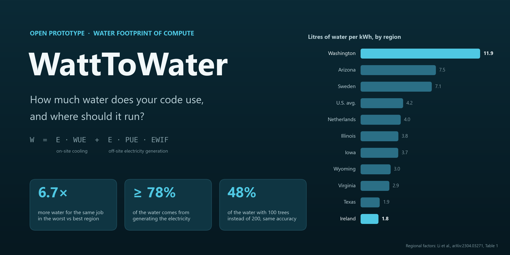
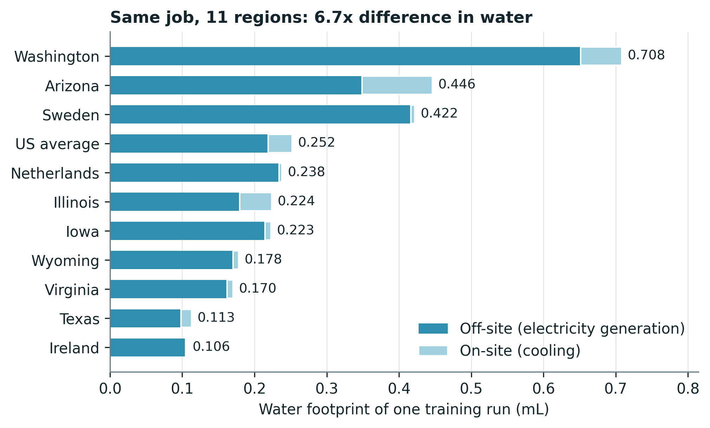

# WattToWater

**A water meter for code.** Developers can't reduce what they can't see. WattToWater shows
how many litres of water a compute job uses in 11 data-center regions, where that water is
scarce, and which choice cuts it: a smaller model or a different region.

Water is split into on-site cooling water and off-site water used to generate the
electricity, and shown next to WRI Aqueduct baseline water stress. Litres and scarcity are
never merged into one score.

## The solution in three levels

| Level | Who | What WattToWater gives them | How |
|---|---|---|---|
| 1. Developer | anyone running Python | the water footprint of every run, with one line | `@track_water` |
| 2. Team | a repo, a CI pipeline | a water report on every push | `python -m watttowater report`, GitHub Actions |
| 3. Organisation | whoever picks cloud regions or model sizes | a ranking under a water-stress policy, and the cheapest model at the same quality | `python -m watttowater regions --max-stress 2`, `compare()` |

## 1. One line in your code

```python
from watttowater import track_water

@track_water(region="Virginia")
def train():
    ...
```

```
[WattToWater] train: 5.68 s, 6.77e-05 kWh -> 0.120 mL (Ireland) to 0.804 mL (Washington) | Virginia: 0.194 mL, water stress 2.56 Med-High
```

Works on any block too (`with track_water("nightly-train"): ...`). Every run is appended
to `water_log.csv` (or `$WATTTOWATER_LOG`). See [examples/quickstart.py](examples/quickstart.py).

## 2. A water report for the team

```bash
python -m watttowater report water_log.csv --region Virginia
```

Prints a Markdown summary: total water, the same work in the best and worst region, and
which job uses the most. In GitHub Actions it is written to the job summary page of every
run: see [.github/workflows/water-report.yml](.github/workflows/water-report.yml).

## 3. Decisions: where and what to run

```bash
python -m watttowater regions --max-stress 2
```

Ranks regions by litres per kWh and marks those above a water-stress policy limit
(5 of 11 pass at stress ≤ 2; best: Ireland, 1.78 L/kWh).

```python
from watttowater import compare
compare({"50 trees": job50, "100 trees": job100, "200 trees": job200})
```

Measures model variants and suggests the cheapest one within 0.5 percentage points of the
best result. In our run: 50 trees reached 95.95 % accuracy (200 trees: 95.90 %) with 23 % of
the water. See [examples/model_size.py](examples/model_size.py).

## Live demo

```bash
python -m watttowater --max-stress 2
```

Trains the benchmark model live and prints all 11 regions with litres, on-site share and
water stress, plus the recommended regions under the policy.

## Key results (paper)

| Finding | Number |
|---|---|
| Same job, best vs worst region | 0.106 mL (Ireland) vs 0.708 mL (Washington), **6.7×** |
| Share of water that is off-site (electricity) | at least **78 %** in every region |
| Litres and scarcity disagree | Texas: 2nd-lowest litres, **High** water stress |
| Smaller model | 100 trees: **48 %** of the energy and water, accuracy 96.15 % vs 95.90 % |

Paper (IEEE format): [WattToWater_IEEE.pdf](WattToWater_IEEE.pdf).
All numbers are estimates for comparison, not measurements of any real facility.



## Install and run

```bash
pip install -r requirements.txt
```

```bash
python -m pytest tests
```

```bash
python analysis.py
```

On Windows, `py` works in place of `python`. `analysis.py` regenerates every table
(`outputs/`) and figure (`figures/`, `paper/figures/`) of the paper from the recorded runs.

## Method in one line

```
W = E · WUE  +  E · PUE · EWIF
    on-site     off-site (electricity generation)
```

`E` is estimated from CPU utilisation: `P = P_idle + (P_base − P_idle) · u`, with
P_base = 45 W (Intel processor base power for the i5-12450H) and P_idle = 5 W (our
assumption). Set your own machine's values with `WATTTOWATER_TDP_W` and
`WATTTOWATER_IDLE_W`.

## Files

| File | Purpose |
|---|---|
| `watttowater/` | The package: `data.py` (factors, stress), `meter.py`, `tracker.py`, `advisor.py`, `report.py`, `demo.py` |
| `examples/` | One-line tracking and model-size comparison |
| `tests/` | Checks that the model reproduces the paper's numbers |
| `analysis.py` | All paper tables and figures |
| `results.csv`, `tradeoff.csv` | Recorded measurements |
| `log_runs.py`, `tradeoff.py` | Scripts that recorded them |
| `paper/` | IEEE LaTeX source of the paper |
| `banner.py` | Banners (`figures/banner.png`, `figures/banner_wide.png`) |
| `watttowater_map.html` | Interactive map (open in a browser) |

## Sources

- P. Li, J. Yang, M. A. Islam, S. Ren, *Making AI Less "Thirsty"*, arXiv:2304.03271, Table 1.
- WRI Aqueduct 4.0 Country Rankings, `Aqueduct40_rankings_download_Y2023M07D05.xlsx`.
- Intel Core i5-12450H product specifications, intel.com (processor base power 45 W).

Environment: Python 3.12.0, scikit-learn 1.3.2, NumPy 1.26.4, psutil 7.2.2, Windows 11.
